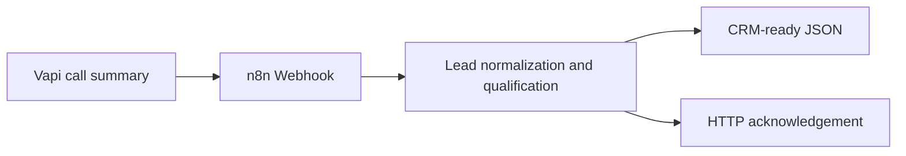

# AI Voice Agent & CRM-Ready Lead Qualification | Vapi + n8n

An importable n8n workflow demonstrating how a Vapi **end-of-call-report** event can become normalized, CRM-ready lead data. Includes fictional sample calls, an illustrative assistant configuration, and local JSON validation.

> **Portfolio demonstration:** No live phone calls, CRM writes, SMS, appointment bookings, or production webhook authentication are included. No client results are claimed.

## Workflow



## Contents

- `workflows/vapi-lead-qualification-demo.json` — n8n importable workflow
- `examples/end-of-call-report.json` — fictional qualified lead event
- `examples/opt-out-report.json` — fictional opt-out scenario
- `examples/vapi-assistant-template.json` — illustrative Vapi assistant configuration (review against your account's current schema)
- `scripts/validate_json.py` — verifies demo JSON parses and workflow has nodes
- `docs/architecture.md` — architecture and production-readiness checklist

## Quick start

1. Open n8n → Workflows → Import from File, and select `workflows/vapi-lead-qualification-demo.json`.
2. Open **Vapi Webhook** and click **Listen for test event**. Copy its **test URL**.
3. Send the sample event (below) to the test URL. Replace the placeholder URL with your own:

```bash
curl -X POST 'YOUR_N8N_TEST_WEBHOOK_URL' \
  -H 'Content-Type: application/json' \
  --data-binary @examples/end-of-call-report.json
```

4. Inspect the **Normalize and Qualify Lead** node output. It produces `lead`, `qualification`, and `crmPayload` objects.
5. Repeat using `examples/opt-out-report.json` and confirm `crmPayload.status` is `do_not_contact`.
6. To test with Vapi, configure an approved `end-of-call-report` message route to a production n8n webhook **only after** setting up suitable authentication, consent controls and testing.

The workflow returns a small HTTP acknowledgement. It does **not** send lead information to a CRM. Extend it with an authenticated CRM node only after proper validation.

## Example CRM-ready fields

`external_call_id`, `full_name`, `email`, `phone`, `notes`, `status`, `appointment_requested`.

## Validate project files

```bash
python scripts/validate_json.py
```

## Security and compliance

Do not upload real customer data, transcripts, authentication tokens, or client-owned workflow exports. See [architecture and production notes](docs/architecture.md) for webhook validation, opt-out handling, idempotency, retries, and privacy considerations.

## Stack

n8n · Vapi (illustrative configuration) · JavaScript Code node · JSON · Webhooks

## Scope

This repository showcases webhook event processing and lead-data mapping. Outbound dialing, call consent enforcement, CRM writes and calendar bookings are **not** implemented in this demo.
