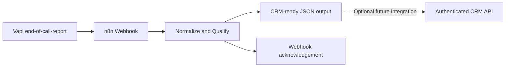

# Architecture (demonstration)

This is a working **event normalization demonstration** using fictional data. It does not perform outbound calling, book appointments or update a CRM automatically. Those capabilities require separate approved integrations and production controls.

## Before production

- Verify webhook authenticity using a supported mechanism or authenticated gateway before processing data; do not expose an unsecured endpoint.
- Check applicable calling consent, quiet hours, privacy, and do-not-call requirements.
- Store API credentials in n8n credentials or secret management, not in workflow exports.
- Add idempotency based on `callId`, error handling, retries and observability.
- Treat transcript-derived structured data as untrusted and validate before sending to a CRM.
- Use opt-out flag to suppress follow-ups immediately; do not contact opted-out records.
- Confirm compatibility with your Vapi assistant schema and n8n version. Vendor schemas can change.
